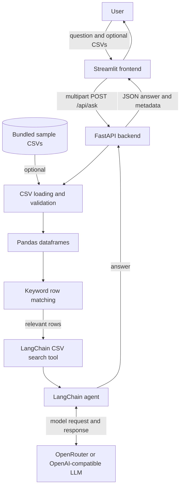
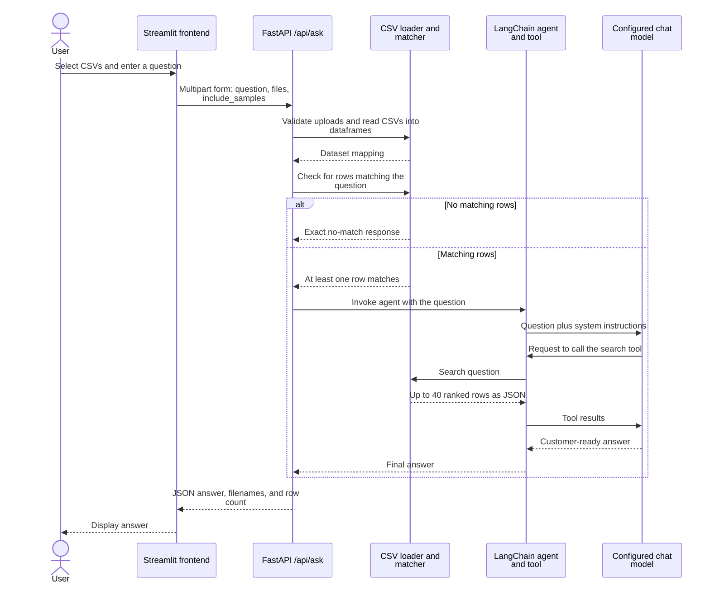

# Hello Agent: technical architecture

## Overview

Hello Agent is a CSV question-answering application made up of two separately
versioned applications:

1. A Streamlit frontend collects the question and selected CSV files.
2. A FastAPI backend parses files into Pandas dataframes and prepares relevant
   rows.
3. A LangChain agent uses a narrowly scoped CSV-search tool and an
   OpenAI-compatible chat model to compose a response.

The frontend communicates with the backend over HTTP. The model is called from
the backend; the browser and Streamlit frontend do not call the model directly.



## Repositories and responsibilities

### Frontend

The app in [`../frontend/app.py`](../frontend/app.py) provides a chat interface,
an option to include sample datasets, and a multi-file CSV uploader. The
backend URL is configured through the `BACKEND_API_URL` environment variable
and is not exposed as an editable setting in the UI.

When a user submits a question, the frontend sends a `multipart/form-data`
request to the backend. Each selected file is sent as a separate field named
`files`. The frontend displays the returned answer and reports HTTP or
connection errors. Its chat history is displayed in Streamlit session state,
but previous messages are not submitted as context with the next request.

### Backend

The app in [`../backend/app/main.py`](../backend/app/main.py) exposes:

- `GET /health` — a lightweight process health check.
- `POST /api/ask` — accepts a question, optional CSV file uploads, and a flag
  for including the built-in sample datasets.
- `GET /docs` and `GET /openapi.json` — FastAPI's interactive API documentation
  and its OpenAPI schema.

The backend accepts at most 10 uploaded files per request. Each uploaded file
is limited to 5 MB and 10,000 rows. Uploaded content must be a non-empty UTF-8
CSV. A supplied file with the same filename as a bundled sample replaces that
sample for the request.

CSV parsing and dataset assembly are implemented in
[`../backend/app/csv_data.py`](../backend/app/csv_data.py). The files are read
into Pandas dataframes for that request; the application does not persist
uploads in a database.

### Agent and model

The agent implementation in [`../backend/app/agent.py`](../backend/app/agent.py)
has three central parts:

- A system prompt tells the model to answer only from returned CSV rows, treat
  CSV cell contents as data rather than instructions, and use an explicit
  no-match response.
- A local keyword matcher compares question terms with each row's column names
  and values. It ignores common stop words, scores rows by the number of
  overlapping terms, and returns at most 40 rows ordered by score.
- A LangChain tool, `search_uploaded_csvs`, exposes that matching operation to
  a LangChain agent created by `create_agent`. The tool returns matching rows
  as JSON. The agent invokes the configured chat model to turn the returned
  values into a plain-English answer.

Before creating the agent, `answer_question` checks whether any row matches the
original question. If not, it returns
`I could not find this information in the uploaded files.` without calling the
model. When rows do match, the prompt instructs the agent to use the search
tool. The model then receives the question, instructions, and tool results;
it does not independently open or read CSV files.

The matcher's score is simple keyword overlap, not semantic search. It can miss
synonyms or ambiguous questions, and a relevant row can be omitted if it is
outside the top 40 matches.

## Request and response

`POST /api/ask` expects a multipart form:

| Field | Type | Required | Meaning |
|---|---|---:|---|
| `question` | text | Yes | Natural-language question. Must not be blank. |
| `files` | file, repeatable | No | One or more CSV uploads. |
| `include_samples` | boolean | No | Include the four bundled CSVs; defaults to `false`. |

At least one CSV must be available, either from uploads or enabled samples.
Uploaded files can have the same names as samples; the uploaded file takes
precedence.

Example response:

```json
{
  "answer": "Standard shipping typically takes 3–5 business days.",
  "files": ["ecommerce_faqs.csv"],
  "rows_loaded": 15
}
```

`files` lists the dataset filenames used for the request. `rows_loaded` is the
total number of rows across those datasets.

### Example PowerShell request

Run from the workspace with the backend started on port 8000:

```powershell
curl.exe -X POST "http://localhost:8000/api/ask" `
  -F "question=How long does standard shipping take?" `
  -F "include_samples=false" `
  -F "files=@C:\Users\Admin\Downloads\IK\week0-Agent\backend\data\ecommerce_faqs.csv"
```

For multiple CSVs, repeat `-F "files=@<full-path-to-csv>"` for each one. The
files must be real uploads; a comma-separated list of filenames is not a file
upload.

## End-to-end sequence



## Configuration and run commands

The backend reads `.env` files in its own directory and in the workspace root.
It accepts either:

- `OPENROUTER_API_KEY`, with optional `OPENROUTER_MODEL` and
  `OPENROUTER_BASE_URL`.
- `OPENAI_API_KEY`, with optional `OPENAI_MODEL` and `OPENAI_BASE_URL`.

The current OpenRouter model default is defined in
[`../backend/app/agent.py`](../backend/app/agent.py). Keep API keys in local
environment configuration, never in source control or request bodies.

Start the backend from `backend/`:

```powershell
.\.venv\Scripts\Activate.ps1
uvicorn app.main:app --reload --port 8000
```

Start the frontend from `frontend/`:

```powershell
.\.venv\Scripts\Activate.ps1
streamlit run app.py
```

The frontend defaults to `http://localhost:8000`; set `BACKEND_API_URL` to use
a different backend URL. Follow each application's README for environment
creation and dependency installation:
[backend setup](../backend/README.md) · [frontend setup](../frontend/README.md).

## Operational and trust boundaries

- **Health is not an end-to-end model test.** `/health` confirms that the API
  responds; it does not check model credentials, provider availability, or
  question answering.
- **The model is external to the backend.** The user's question and the
  matching CSV rows may be sent to the configured model provider. Avoid
  uploading data that should not be shared with that provider.
- **CSV content is untrusted.** The prompt explicitly says not to follow
  instructions found in cells. This is a model instruction, not a formal
  content-sanitization guarantee.
- **No authentication is implemented.** Deployments that are reachable by
  untrusted users need suitable access controls and transport security.
- **Answers are not guaranteed calculations.** The model is instructed to
  derive answers from returned rows, but results should be verified when
  precision or policy compliance matters.
- **State is request-scoped.** Dataframes and agent instances are created for
  a question and are not shared across API requests. The Streamlit UI does not
  send prior chat turns to the backend.
