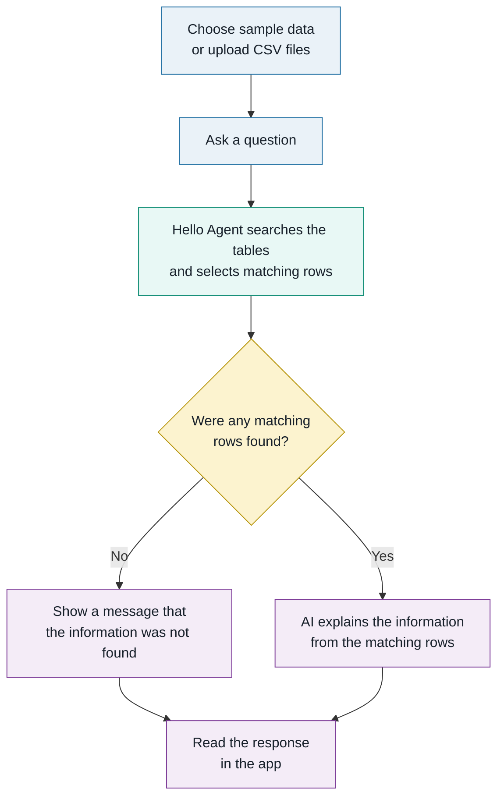

# Hello Agent: how it works

Hello Agent is a helper that answers questions about information in CSV
spreadsheets. A CSV is a simple table: columns describe the kinds of
information, and rows contain individual records.

## The process in plain language

1. **Choose the information.** You can use the provided example spreadsheets,
   upload your own CSV files, or use both.
2. **Ask a question.** For example: “How long does standard shipping take?”
3. **Hello Agent checks the tables.** The backend reads the CSVs and looks for
   rows whose words overlap with the question. It keeps the best-matching rows
   to provide to the AI.
4. **The AI writes a response.** A language model is instructed to use the
   information returned from those rows, not its general knowledge, and to
   explain it in clear language.
5. **See the answer.** The web app displays the response along with which
   dataset files were used and how many total rows were loaded.

## Example

Suppose the ecommerce spreadsheet includes a row saying standard domestic
shipping takes 3–5 business days, with longer estimates for some destinations.
If you ask, “How long does standard shipping take?”, the application finds that
row and gives the AI its contents. The AI can then summarize the delivery
estimate in a readable answer.

If you ask about something that does not appear in the selected spreadsheets,
Hello Agent is designed to respond:

> I could not find this information in the uploaded files.

## What “reasoning” means here

The AI does not open the spreadsheet by itself. The application first looks
for matching rows and gives those rows to the AI. The AI uses the question,
the rows it receives, and instructions about how to respond to write the final
answer.

This is a little like asking a colleague to answer a question after you have
found and handed them a few relevant pages. The colleague can explain the
pages, but cannot reliably answer a question if the right information was not
on the pages provided.

## Things to keep in mind

- The search looks for overlapping words, so a question using very different
  wording from the spreadsheet may not find the right row.
- Only a limited number of matching rows are sent for an answer. If the files
  contain many similar rows, the most relevant information could be missed.
- The AI can misunderstand or summarize a value incorrectly. Check the source
  data for decisions that need to be exact.
- If an API key is configured, the question and matching spreadsheet rows are
  sent to the selected AI provider to generate the answer. Only upload data
  that is appropriate to share with that provider.
- The conversation shown in the app is not carried forward as context for the
  next question. Ask a complete question each time.

For setup, endpoints, and implementation details, see the
[technical architecture guide](architecture.md), the
[backend instructions](../backend/README.md), and the
[frontend instructions](../frontend/README.md).
